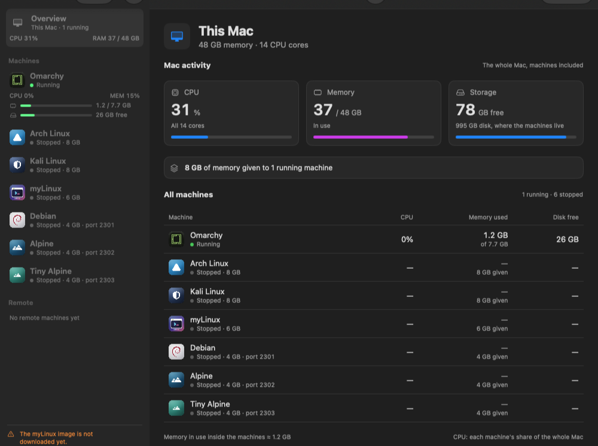
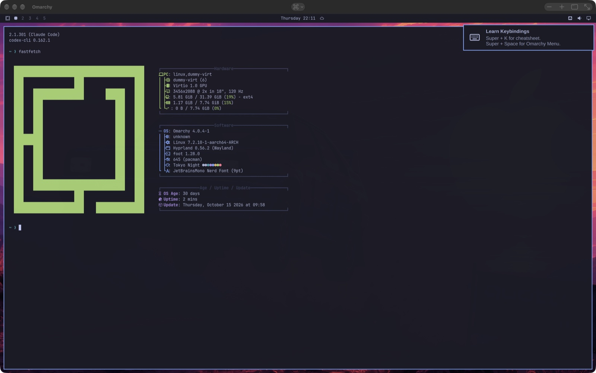

# myLinux

**Linux on your Mac, ready in seconds.** myLinux Launcher is a free Mac app that runs Omarchy, Arch Linux, Kali,
Debian, Alpine and Windows 11 as real machines on Apple silicon. Pick one, press Start, and it runs as an app of its
own, with its own disk, your clipboard and your folders. Your coding agents can make them for you.

**[mylinux.app](https://mylinux.app)** · **[Download for Mac](https://mylinux.app/download)** ·
**[Docs](https://mylinux.app/docs)** · [Video: Omarchy on your Mac in 10 sec](https://youtu.be/CH33yNoNvp8)



## The machines

Each kind downloads once, and every machine gets its own disk from that download. Times are a machine's second
start on a MacBook Pro with an M4 Pro: until the desktop is on screen, or a server answers over SSH.

| Machine | What it is | Download | Ready in |
|---|---|---|---|
| Omarchy | Arch Linux with Hyprland, run from the keyboard: the [Try Omarchy](https://github.com/omacom/try-omarchy) project's signed image | 1.7 GB | 9 s |
| Arch Linux | KDE Plasma with a taskbar, a start menu and Firefox, built here from Arch Linux ARM's packages | 2 GB | 7 s |
| Kali Linux | Xfce with nmap, Metasploit, Wireshark and Kali's other top tools, built here from Kali's packages | 2 GB | 7 s |
| myLinux | Our own small desktop that runs from memory (this repository's Buildroot image) | 110 MB | 3 s |
| Debian | The latest stable Debian as a terminal, with a browser that sees inside the machine | 300 MB | 11 s |
| Alpine | A small server that idles in about 60 MB | 100 MB | 16 s |
| Tiny Alpine | Alpine's 15 MB core on myLinux's kernel: the machine to make many of | 18 MB | 2 s |
| Windows 11 | Windows for Arm, from your own Microsoft ISO; installs itself without questions | 8 GB (yours) | 15–40 min, once |

Everything runs natively on Apple's hypervisor through QEMU. Nothing is emulated.



## Get started

1. You need an Apple-silicon Mac (M1 or newer) with macOS 15 or newer.
2. [Download myLinux Launcher](https://mylinux.app/download). It is 40 MB, signed with a Developer ID and notarised
   by Apple. Drag it to Applications and open it.
3. The Welcome sheet lists the Linux machines. Tick the ones you want and press **Download**.
4. Select a machine and press **Start**.

For Omarchy and Windows, the new-machine dialog takes their first-start questions up front (account, keyboard, time
zone), so the machine sets itself up by itself. Its two boxes, **Install Claude Code** and **Install Codex**, put
both agents in the first terminal (`cc`, `cx`). The launcher updates itself, and your machines keep running through
an update.

## Ask your coding agent for a machine

The launcher has a command, `mylinux`, and a skill that teaches Claude Code and Codex to use it. Install the skill
from **File › Install the Agents' Skill…** or with `mylinux skill install`, then ask in plain words:

```text
install tiny alpine 1/20 called tester1 and put claude code on it
make me a debian box named build with 4 GB
install omarchy with claude code and codex
run uname -a in tester1
delete tester1
```

The command lives inside the app at `/Applications/myLinux Launcher.app/Contents/Resources/bin/mylinux` and answers
in JSON: `create`, `start`, `stop`, `status`, `wait`, `ssh`, `claude`, `codex`, `delete` and more. The skill never
pastes a token or invents a password, and it deletes only what you name. See
[the command reference](https://mylinux.app/docs#cli).

## It works with your Mac

- **Its own app:** every machine sits in the Dock and in ⌘Tab, and keeps running when the launcher quits.
- **One clipboard:** copy on the Mac, paste inside, and back. Omarchy, Arch, Kali and Windows share pictures too.
- **Your folders:** each Linux machine has a Mac folder at `~/Mac`. Dropbox, OneDrive, iCloud Drive and Google
  Drive can go in too, and **Mount a Share…** mounts a NAS.
- **Snippets:** ready commands for each system. Copy one, or paste it straight into the machine's terminal.
- **Windows and keys:** sharp on Retina, with Fill Screen and full screen. ⌘ goes to the machine or stays with
  macOS, as you choose.
- **Servers** open in Ghostty with tabs and splits, beside a browser pane that sees the machine's own `localhost`.
- **Other computers:** VNC and SSH to your other machines, your Tailscale network one click away, and ⌘K to find any
  machine.

Everything is explained at **[mylinux.app/docs](https://mylinux.app/docs)**.

## This repository

The launcher, the scripts it runs, the myLinux image, and the builds of the Arch Linux and Kali images.

```
mac/                        the launcher (SwiftUI); mac/build-app.sh builds it, mac/release.sh makes a notarised DMG
run.sh                      a myLinux machine; run-omarchy.sh runs Omarchy (and Arch Linux and Kali with
                            DESKTOP=arch or DESKTOP=kali), run-server.sh the servers (run-debian.sh, run-alpine.sh,
                            run-tiny.sh), run-windows.sh Windows
tools/                      downloads (get-*.sh), image builds, the QEMU runtime build, checks and helpers
omarchy/ arch/ kali/        what goes into those guests: Omarchy's first-start answers and session agent, the
                            clipboard and display-scaling agents of Arch Linux and Kali
tiny/ windows/              Tiny Alpine's init, and Windows's tools disc (answer files, the agents' setup)
server-apps/                myLinux Apps, snippets and the agents' setup, loaded by the machines from main
skills/mylinux/             the agents' skill (SKILL.md)
claude-bootstrap/           the Claude Code installer behind curl -fsSL https://mylinux.app/claude | sh
configs/ board/ package/    the myLinux image: Buildroot defconfig, rootfs overlay and packages
shell/ app/ patches/        the myLinux desktop (a Qt Wayland compositor in C++ and QML) and its Qt patch
```

Releases (the launcher, the QEMU runtime and the guest images) are in
[mylinux-releases](https://github.com/adminmylinux/mylinux-releases). `PLAN.md` records the design decisions.

### Run machines from a checkout

```bash
git clone https://github.com/adminmylinux/mylinux.git && cd mylinux
tools/get-qemu-runtime.sh   # myLinux's own QEMU 11.1 (Metal-accelerated virgl) into out/qemu-runtime
tools/get-image.sh          # the latest myLinux kernel and root filesystem into out/, SHA-256 checked
./run.sh
```

The other machines start the same way after their `tools/get-*.sh` (`get-omarchy.sh`, `get-arch.sh`, `get-kali.sh`,
`get-debian.sh`, `get-alpine.sh`, `get-tiny.sh`, `get-windows.sh`). `DRYRUN=1 ./run.sh` prints the QEMU command
instead of starting it. Settings › Developer points the launcher at a checkout, and it then starts machines from its
scripts and `out/`.

### Build the launcher

```bash
mac/build-app.sh            # out/mac/myLinux Launcher.app (--install copies it to /Applications)
```

It needs Xcode's Swift and libvncclient (`tools/build-libvncclient.sh`, or Homebrew's `libvncserver`).
`tools/get-ghosttykit.sh` fetches the pinned Ghostty terminal package.

### Build the myLinux image

The build runs in [OrbStack](https://orbstack.dev), in a Debian machine named `debian`, because Buildroot needs a
case-sensitive filesystem. The build tree lives at `~/br` inside it, and the repository stays on the Mac.

Inside the Debian machine (`orb -m debian`):

```bash
sudo apt install -y build-essential git cmake ninja-build python3 rsync bc wget cpio unzip file \
  libncurses-dev libssl-dev bzip2 xz-utils zstd perl-modules ccache gawk texinfo patch
mkdir -p ~/br && cd ~/br && git clone --branch 2026.08 --depth 1 https://gitlab.com/buildroot.org/buildroot.git
mkdir -p ~/br/output ~/br/dl
```

Then from the Mac, in this repository:

```bash
tools/buildroot-patch.sh        # small Buildroot fix for Qt 6.11 wayland features
orb run -m debian sh -c "cd ~/br/output && make O=\$PWD BR2_EXTERNAL=$PWD -C ~/br/buildroot mylinux_defconfig"
./build.sh                      # first build ~1 h on 13 cores (toolchain, Qt, Mesa, kernel), later builds minutes
tools/sdk-update.sh             # once: the SDK for the fast loop below
tools/app-build.sh shell        # the desktop shell into share/, picked up at the next shell restart
```

The Arch Linux and Kali images are built in the same OrbStack machine, as root: `tools/build-arch-image.sh` and
`tools/build-kali-image.sh`.

### Checks and tests

```bash
tools/check.sh              # the checks and tests of what changed since the last release
tools/check.sh --all        # every test
tools/vmtest/vmtest.py      # boots a throwaway myLinux VM and runs the smoke scenarios
```

## Licence

GPL-3.0-or-later (see `LICENSE`). The desktop shell links the Qt Wayland Compositor module, which Qt offers under the
GPL v3 only. Theme palettes are from Omarchy (MIT, see `board/overlay/usr/share/mylinux/themes/LICENSE.omarchy`);
the Inter font is under the SIL OFL. The terminal is Ghostty's (MIT), through GhosttyKit (MIT,
Lakr233/libghostty-spm); myLinux Apps is made with Textual (MIT), and VNC is libvncclient's (GPL-2.0-or-later). The
QEMU runtime lists its sources and licences in its `NOTICES.md`.

The launcher's Welcome sheet shows two marks in `tools/icons/`: `debian.png` is the Debian Open Use Logo, Copyright
(c) 1999 Software in the Public Interest, Inc., under LGPL-3 or CC-BY-SA 3.0; `omarchy.png` is the Omarchy mark from
Omarchy's brand kit (as used by Try Omarchy), a pending trademark of the Omarchy project. Omarchy is by its own
authors; Arch Linux, Kali Linux, Debian and Alpine Linux are trademarks of their projects, and Windows is Microsoft's.
